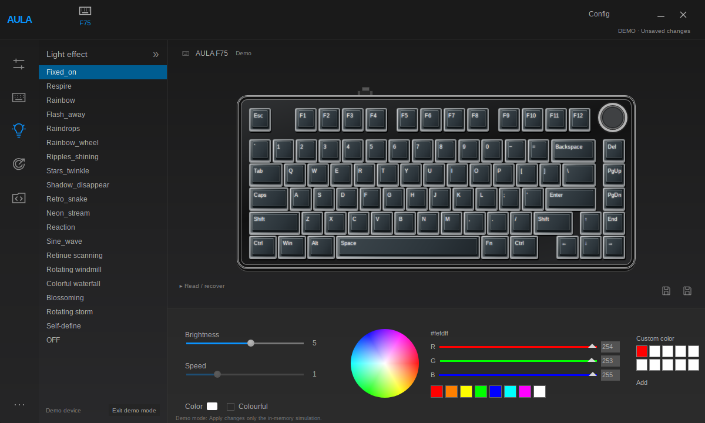
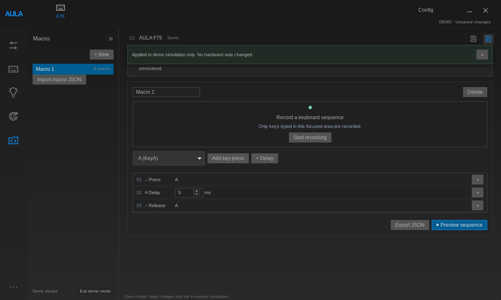

<div align="center">


# AULA Studio

### Your F75, at home on Linux.

Native configuration for the original ANSI AULA F75.<br>
Rust · Tauri · React · Wayland · MIT

**Early access · v0.4.2 · USB wired configuration**

[Website](https://dahuum.github.io/aula-studio/) · [Downloads](https://github.com/Dahuum/aula-studio/releases) · [Get started](#get-started) · [What works](#what-works) · [Documentation](#documentation) · [Contribute](CONTRIBUTING.md)



*Actual native application in explicit demo mode, using independently drawn artwork.*

</div>

AULA Studio brings F75 lighting, configuration reads, profiles and local editing tools to a Linux desktop. It uses the existing Linux HID interface: launch as your normal user, without Wine, a VM, a browser configurator or a privileged daemon.

This is an independent community project, **not affiliated with AULA**. It is under active development. Hardware coverage is deliberately narrow, and implemented controls are not all physically validated.

## What works

| Capability | Current status |
| --- | --- |
| Wired detection; configuration, palette, base/Fn and per-key bank reads | Verified on physical hardware |
| Theme switching | Visually confirmed by the keyboard owner |
| Scoped brightness change and restoration | Physically tested: **6 → 5 → 6**, both writes read back, all five banks restored exactly |
| Preset effects/colors, brightness/speed, per-key RGB, base/Fn keyboard and seven media assignments, sleep and scoped restoration | Real reviewed HID transactions implemented; other write scopes still need physical validation |
| Profiles, import/export, history, preferences and diagnostics | Implemented and software-tested |
| Local macro recording, editing, import/export and offline preview | Implemented; preview does not inject keys into other applications |
| Onboard macro uploads; wireless configuration | **Unavailable** |
| Debounce, polling, OS/revision settings and broader shortcut bindings | Under investigation |

**96 passing Rust tests and 37 passing frontend tests**, plus native GUI and startup integration checks, are separate from hardware validation. See the [compatibility matrix](docs/FEATURE_MATRIX.md), [test record](docs/TESTING.md) and [remaining work](docs/ROADMAP.md).

**Supported target:** original **ANSI F75**, USB wired mode, `258a:010c`, configuration interface 1 with report `0x06` / 520 bytes. Tested development environment: Arch Linux, Hyprland and Wayland. Other F75 variants, ISO layouts, revisions, Bluetooth and receiver configuration are not assumed compatible. Receiver detection alone does not establish wireless configuration support.

## Get started

### Build from source

Use current stable Rust and Node/npm. Arch build dependencies include `base-devel`, `pkgconf`, `gtk3`, `webkit2gtk-4.1`, `systemd-libs` and `libayatana-appindicator`. Python 3.11+ is used by developer scripts. Dependencies are not installed automatically.

Clone the repository and build:

```sh
git clone https://github.com/Dahuum/aula-studio.git
cd aula-studio
npm --prefix app ci
npm --prefix app run build
cargo build --locked --release -p aula-studio -p aula-cli
./target/release/aula-studio
```

The release bundles its frontend and uses system WebKitGTK. A development web server is not needed. REA, Ghidra and Windows software are analysis tools, **not runtime dependencies**.

### Portable build or Arch package

The portable archive requires compatible GTK/WebKitGTK system libraries. Extract it and run:

```sh
./aula-studio-0.4.2-linux-x86_64/bin/aula-studio
```

Build releases locally with `./scripts/build-release.sh`. The [installation guide](docs/INSTALLATION.md) covers Arch packaging, the optional USB permission rule, troubleshooting, data paths and uninstalling. Building never installs a package, rule, driver or service.

Version 0.4.2 handles TTY launch without display variables when a unique user-owned Wayland display is available. It changes only its own environment. Ambiguous or unavailable displays produce a useful error instead of a GTK panic.

## Try it without a keyboard

Choose **Enter demo mode** at the bottom of the sidebar. Explore the editors, save profiles and record local macros. Demo Apply changes only an in-memory simulation and is labeled accordingly.

<details>
<summary>See the local macro editor</summary>



Local and onboard macros are distinct. Hardware uploading remains disabled until its protocol and recovery behavior are established.

</details>

## Apply a hardware change

1. Connect the supported keyboard in **wired mode** and exit demo mode.
2. Edit the relevant page. **Save profile** saves locally; it does not configure hardware.
3. Choose **Review … write**. Preparation reads the affected configuration and saves a durable backup.
4. Check the device, exact changes, scope and backup, then explicitly choose **Write … to keyboard**.
5. Success requires matching readback. Power-cycle persistence is still unverified.

Reviews expire after 120 seconds and are single use. Startup, hotplug and profile save/load never apply configuration. Failures are reported as unconfirmed, without automatic retry or rollback. The CLI has no configuration-write commands.

Known ANSI Fn and function-key input sources are protected. Scoped restoration preserves unknown bytes and protected entries; it is not a factory reset or arbitrary memory clone. Read the [hardware safety contract](docs/HARDWARE_SAFETY.md) before exercising an unvalidated scope. Do not run multiple configurators against the same device concurrently.

> **Upgrading an older development build?** Use version 0.4 or newer for mapping/per-key operations. Versions 0.1–0.3 had an incorrect French-derived ANSI bottom-row assignment; current versions protect Fn at slot 53 and map Right Ctrl to slot 59. No mapping/per-key write was performed during that earlier development.

## Diagnostics

```sh
./target/release/aula devices
./target/release/aula diagnostics
./target/release/aula validate path/to/profile.json
```

Enumerate before using a path: `/dev/hidrawN` changes after reconnection. Bounded reads are documented in the [installation and diagnostics guide](docs/INSTALLATION.md). Sanitize reports; do not upload the installer, serials, personal paths or full hardware backups.

## Development

```sh
cargo test --workspace --locked
cargo clippy --workspace --all-targets --locked -- -D warnings
npm --prefix app test
npm --prefix app run build
```

Hot reload: `cd app && npm run tauri dev -- --no-default-features`.

Hardware communication is separate from the UI. `aula-protocol` owns typed packets and validation, `aula-hid` provides transport and transactions, and `aula-service` owns profiles and persistence. Tauri manages reviews, backups and journals. Mock transports and explicit demo mode keep ordinary tests off the keyboard.

Read [CONTRIBUTING.md](CONTRIBUTING.md) before adding protocol operations. Standard automation must block physical writes. A successful mock test is not hardware verification.

## Documentation

- [Install, permissions, troubleshooting and uninstall](docs/INSTALLATION.md)
- [Compatibility](docs/FEATURE_MATRIX.md) · [Limitations](docs/LIMITATIONS.md) · [Roadmap](docs/ROADMAP.md)
- [Protocol](docs/PROTOCOL.md) · [Architecture](docs/ARCHITECTURE.md)
- [Reverse-engineering evidence](docs/REVERSE_ENGINEERING.md) · [Sources and attribution](docs/SOURCES.md)
- [Hardware safety](docs/HARDWARE_SAFETY.md) · [Testing](docs/TESTING.md) · [Changelog](CHANGELOG.md)
- [Security reporting](SECURITY.md)

## License and provenance

Original code is [MIT licensed](LICENSE). Attributed MIT F87-family fixture buffers retain their own [license](fixtures/keymap/LICENSE) and are never treated as F75 factory defaults. Dependencies retain their respective licenses.

No proprietary installer, EXE/DLL, decompiler output or original artwork is distributed. Optional user-supplied artwork is read locally; the app also works with independently drawn assets. The original UI recreation is **unfinished**, particularly keyboard artwork/fonts and several panel layouts. This project does not claim full Windows-software parity.
